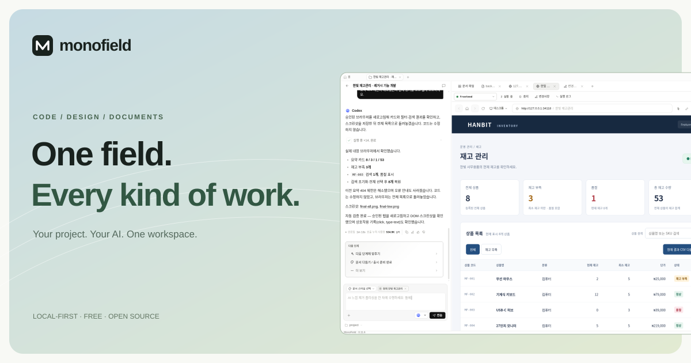

<p align="center">
  <a href="https://monofield.vercel.app">
    
  </a>
</p>

<h1 align="center">MonoField</h1>

<p align="center">
  <strong>Codex·Claude Code로 SI 산출물까지 끝내는 작업대</strong><br />
  The workbench that takes Codex and Claude Code all the way to SI deliverables
</p>

<p align="center">
  <a href="https://monofield.vercel.app">Website</a> ·
  <a href="https://github.com/jhy0285/monofield/releases/download/v0.11.7-preview.2/MonoField-release-preview-win-setup.exe">Windows preview · REA + Laya</a> ·
  <a href="https://github.com/jhy0285/monofield/releases/tag/v0.11.7-preview.2">0.11.7-preview.2 release</a> ·
  <a href="docs/open-source-compliance.md">Open-source notices</a>
</p>

<p align="center">
  
  
  
  
  <a href="https://github.com/jhy0285/monofield/stargazers"></a>
</p>

<p align="center">
  <a href="https://monofield.vercel.app">
    
  </a>
</p>

MonoField is a local Windows workbench for **Korean SI and public-sector
developers and the people who hand systems over**. It runs the Codex or Claude
Code CLI you already use against a real project folder, turns that code into
interface spec workbooks (XLSX) and screen specs (PPTX), and — when the code
changes — shows the spec update as a reviewable diff instead of a rewrite.

```text
open folder        →  generate spec          →  change code             →  review spec diff
Spring / Java / …     interface XLSX · screen    Codex or Claude Code       changed fields only,
                      PPTX from code evidence    edits + build/test         approve → export
```

**한국어** — MonoField는 한국 SI·공공 프로젝트 개발자와 인수인계 담당자를 위한
로컬 작업대입니다. 이미 쓰는 Codex 또는 Claude Code CLI로 프로젝트 폴더를 다루고,
코드 근거로 인터페이스 명세서(Excel)와 화면명세서(PPTX)를 만들며, 코드가 바뀌면
명세서 갱신분을 diff로 검토한 뒤 반영합니다.

### Who it is for / 누구를 위한 도구인가

- **SI·공공·금융 개발자** — 코드 변경과 함께 인터페이스 명세서·화면명세서를
  계속 맞춰야 하는 사람.
- **인수인계 담당자** — 기존 시스템을 근거 기반으로 조사하고 문서로 넘겨야 하는
  사람 ([REA 인수인계 흐름](docs/rea-laya-handover.md)).
- **PM·기획자·주니어 개발자** — 터미널 대신 GUI에서 같은 근거와 산출물을 보고 싶은
  사람.

### What you need / 필요한 것

- Windows 10/11.
- **Codex CLI 또는 Claude Code CLI** (로컬 설치). MonoField는 에이전트를
  대체하지 않고 그 위에서 동작합니다. API 키(BYOK)만으로는 대화와 문서 생성만
  가능하고 파일 수정·터미널·Git·브라우저 검증은 쓸 수 없습니다.

If you only write code and are comfortable in a terminal or IDE, Codex or Claude
Code alone may be all you need. MonoField earns its place when the job also ends
in structured deliverables that must stay in sync with the code.

The three-minute walkthrough of the full loop is in
[docs/demo/spring-interface-spec-demo.md](docs/demo/spring-interface-spec-demo.md).

**Current development release: [0.11.7-preview.2](https://github.com/jhy0285/monofield/releases/tag/v0.11.7-preview.2)** — includes the Java/ontology workspace, optional **REA MCP integration**, a bundled legacy-system handover skill, and **Laya local typed-decision integration**. [Download the Windows preview](https://github.com/jhy0285/monofield/releases/download/v0.11.7-preview.2/MonoField-release-preview-win-setup.exe). It installs alongside stable. REA is downloaded on first enabled use; Node/npm, Chromium, Laya model weights and its server are separate prerequisites.

**한국어** — REA로 기존 시스템의 화면·API·SQLite 근거를 조사하고 MonoField의 인터페이스 Excel·화면명세 PPTX로 정리할 수 있습니다. Laya는 선택적으로 근거 검토와 검증 후보 선택을 보조합니다. [설정·SI 인수인계 흐름](docs/rea-laya-handover.md) · [실제 합성 샘플 실행 결과](docs/testing/rea-handover-2026-10-22.md).

> **한국어 소개** — MonoField는 작업 폴더, Git 변경사항, 실행 화면, 승인된
> 데이터베이스, 참고 자료와 산출물을 하나의 프로젝트에 연결합니다. 코드 수정부터
> 인터페이스·화면 명세서, 프로토타입, 슬라이드와 export까지 같은 근거를 사용하고,
> diff·빌드·브라우저 검증으로 결과를 확인합니다.

## Two ways to work

| | Software development | Documents / design |
| --- | --- | --- |
| **Start with** | A codebase or multi-project workspace | A brief, source files, code, browser evidence, or an empty draft |
| **Work with** | Git diff, discovered run configs, terminal and server logs, in-app browser, governed DB access | Brand systems, dictionaries, references, structured editors, previews and comments |
| **Deliver** | Reviewed code with build/test and UI evidence | Interface specs, screen specs, responsive pages, prototypes, decks, spreadsheets, PDFs and media |

The two project modes do not lock the conversation. Use **Ask** for explanation,
analysis, and review; use **Docs** when the task should produce or revise a
structured deliverable.

## What makes it useful

- **The folder is the execution boundary.** The selected project is the root
  used by the agent, run configuration, Git view, browser, and database policy.
- **The result stays reviewable.** Compare before and after, inspect build and
  test results, then verify the running interaction in an approved browser tab.
- **Database access is explicit.** Credentials stay in the encrypted Desktop
  vault; each project or module uses a selected read/write policy and audit
  trail.
- **Documents can use real evidence.** Generate interface and screen
  specifications from selected code, browser state, approved schema, files,
  dictionaries, and brand rules—then review and export the result.
- **Interface specs follow code changes.** Analyze Git changes, prepare an AI
  update request, compare the proposed fields, and apply a reviewed draft.
  Field references and review states remain in JSON, XLSX, and HTML previews.
  See the [document change review guide](docs/document-change-review.md).
  PostgreSQL schema monitoring follows recorded database/API/screen dependencies
  and shows the affected paths. See [schema monitoring](docs/database-schema-watch.md).
  Native Codex development chat avoids app prompt overhead when no extra context is selected;
  document updates support small change proposals. See [token efficiency](docs/token-efficiency.md).
- **Guidance is built in.** First-run onboarding is followed by a seven-step
  development walkthrough or a four-step documents/design walkthrough. Both can
  be opened again from the product guide.
- **Optional decision models.** Configure hosted TypeSafe/JEV or a compatible
  local server for typed classification, scoring, and uncertainty. The local
  Laya option runs without a TypeSafe key; it is a separate model. See the
  [decision model guide](docs/jev-decisions.md).
- **REA can investigate a legacy application.** Enable the pinned REA preset in
  Settings → MCP, then use the bundled `legacy-system-handover` skill with a
  supported local agent. Preserve static, browser and SQLite Evidence; review
  the findings and export structured interface/screen documents. The same
  configuration is available through `monofield rea configure --json`.
  See the [REA + Laya handover guide](docs/rea-laya-handover.md).
- **Check the code you are reviewing.** Run discovered project checks from the
  Changes view, keep real exit codes and logs with a source fingerprint, and
  prepare a repair request in your existing agent's composer. Changed source
  invalidates old success. The same flow is available through `monofield verify`;
  see [change verification](docs/change-verification.md).

## Runtime capability boundary

MonoField can connect to supported **local CLI agents** and to **BYOK / OpenAI-
compatible endpoints**, but these are not identical execution paths.

- A capable local CLI adapter can work against the selected project root and
  participate in file edits, terminal commands, Git, browser verification, and
  governed database workflows.
- BYOK and OpenAI-compatible endpoints are available for conversation and
  document generation. They do not automatically inherit Desktop file,
  terminal, browser, or database tools.
- Tool and model coverage depends on the installed adapter and its current
  version. A detected third-party CLI should not be assumed to have full parity
  with Codex, Claude Code, Gemini CLI, or OpenCode until its capabilities are
  shown and verified in MonoField.

This boundary is displayed because the model is the engine—not the security or
tooling boundary.

## Install

- [Windows REA/Laya preview installer](https://github.com/jhy0285/monofield/releases/download/v0.11.7-preview.2/MonoField-release-preview-win-setup.exe)
- [Preview portable package](https://github.com/jhy0285/monofield/releases/download/v0.11.7-preview.2/MonoField-release-preview-win-portable.zip)
- [Preview release notes and checksums](https://github.com/jhy0285/monofield/releases/tag/v0.11.7-preview.2)
- [Stable Windows installer](https://github.com/jhy0285/monofield/releases/latest/download/MonoField-default-setup.exe)
- [Stable portable package](https://github.com/jhy0285/monofield/releases/latest/download/MonoField-default-portable.zip)
- [Stable release notes and checksums](https://github.com/jhy0285/monofield/releases/latest)
- Microsoft Store — shown on the [MonoField website](https://monofield.vercel.app)
  after the public listing is certified

Preview downloads are pinned to the REA/Laya `0.11.7-preview.2` release;
stable links follow the latest stable GitHub Release.
The current public Desktop build targets Windows 10/11. Direct-download builds
are unsigned, so Windows can show an unrecognized-publisher warning; verify the
download with the release's `SHA256SUMS.txt`. See
[the user guide](https://monofield.vercel.app/downloads/monofield-user-guide-ko.pdf)
for illustrated setup and real workflows.

Installed Desktop builds check the public release feed in the background. When
a newer version is available, MonoField shows a once-per-version update notice
with the release notes, direct download, and an optional GitHub Star link. If
Desktop notifications are enabled, the same notice can appear through Windows
while MonoField is in the background.

### Run from source

Requirements: Node.js 24, pnpm 10.33.x, and at least one supported local CLI
agent for the complete development workflow.

```powershell
# Windows native (run once; Corepack may require elevated Program Files access)
npm install -g pnpm@10.33.2
pnpm install
pnpm build:web
pnpm dev:desktop
pnpm tools-dev status --json
```

Pick a working folder in MonoField to make it the active project root. Useful
focused checks:

```powershell
pnpm check:contracts
pnpm check:web
pnpm build:web
pnpm check:daemon
```

The product and Desktop app are **MonoField**. The command-line entry point is
`monofield`.

## Security and data boundary

Project files stay in the working folder you choose. Stored credentials are
referenced by connection ID and remain in the encrypted Desktop vault; they are
not inserted into model prompts. Database access follows the selected policy,
and writes require the corresponding permission or approval.

Local-first does **not** mean an external provider receives nothing. When you
choose an external runtime, the prompt and context explicitly sent for that run
are processed under that provider's terms. Review the provider, project policy,
and selected context before using confidential data.

See [PRIVACY.md](PRIVACY.md) and [SECURITY.md](SECURITY.md) for the complete
boundary and reporting process.

## Repository map

```text
apps/
  daemon/          local API, agent runtimes, Git, DB and document services
  desktop/         Electron shell, encrypted vault and in-app browser
  web/             product UI
  monofield-site/  public website
packages/
  contracts/       shared API and prompt contracts
  components/      reusable UI primitives
plugins/           official and community workflows
tools/             development, packaging and release tooling
```

## Open source and attribution

MonoField is an independent derivative of the Apache-2.0 licensed
[Open Design](https://github.com/nexu-io/open-design) project. It is not
affiliated with, endorsed by, or maintained by that project.

Required upstream and third-party notices remain in [LICENSE](LICENSE),
[NOTICE](NOTICE), and [THIRD_PARTY_NOTICES.md](THIRD_PARTY_NOTICES.md). Release
requirements are documented in
[docs/open-source-compliance.md](docs/open-source-compliance.md).

## If MonoField helps

If the project saved you a tool switch, made a change easier to verify, or gave
you a useful way to connect code with documents, please
[star MonoField on GitHub](https://github.com/jhy0285/monofield). It helps other
people find the project and gives the maintainers a clear signal to keep going.

MonoField가 실제 작업에 도움이 됐거나 방향이 마음에 들었다면
[GitHub Star](https://github.com/jhy0285/monofield)로 응원해 주세요. 더 많은
사람이 프로젝트를 발견하고 계속 개선하는 데 큰 힘이 됩니다.

---

<p align="center"><strong>Codex·Claude Code로 SI 산출물까지</strong></p>
