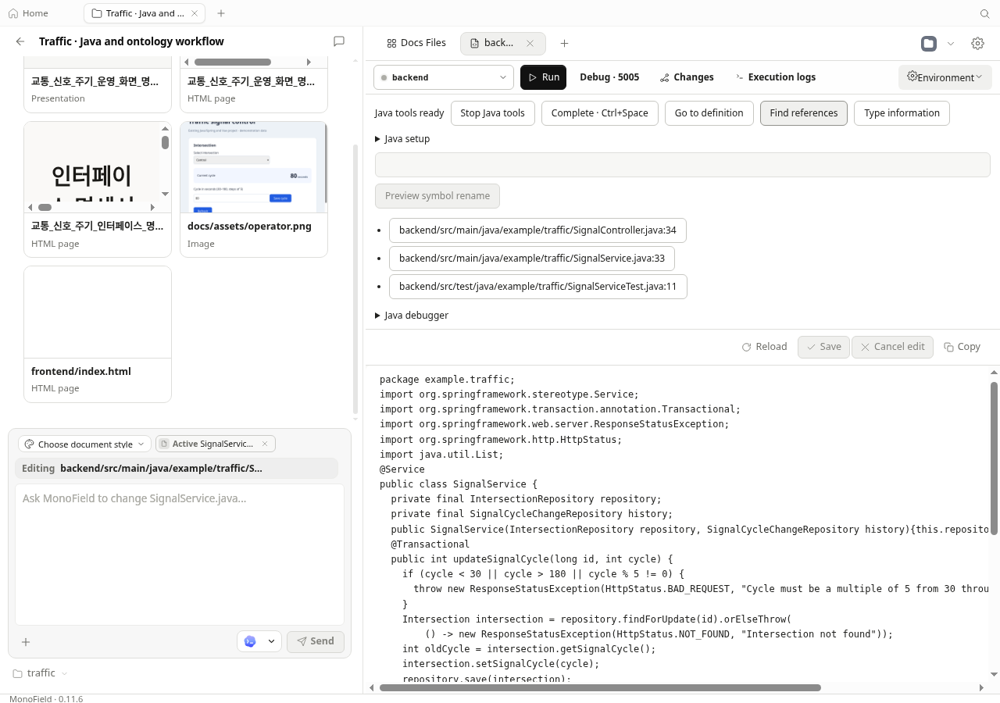
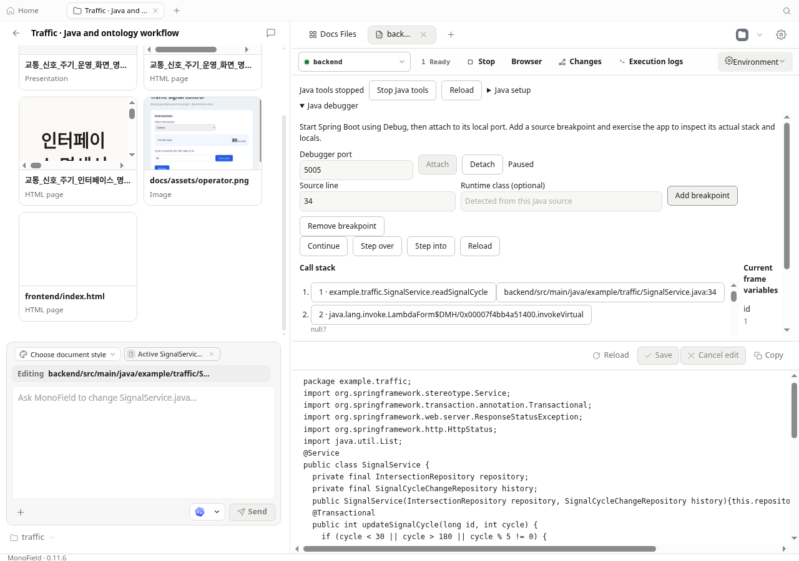
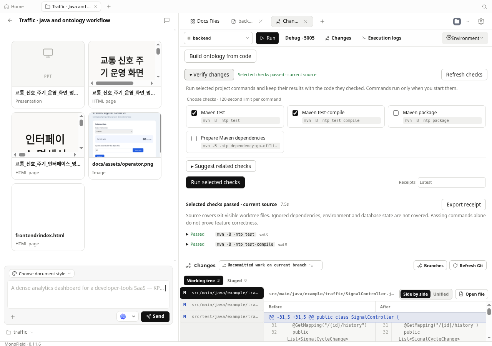
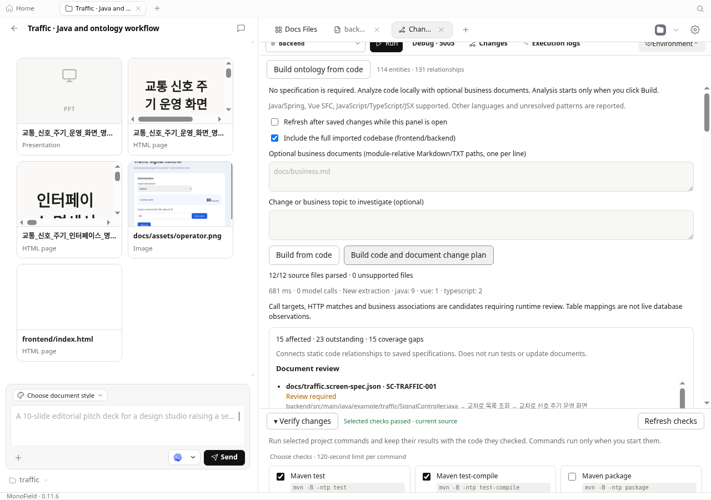
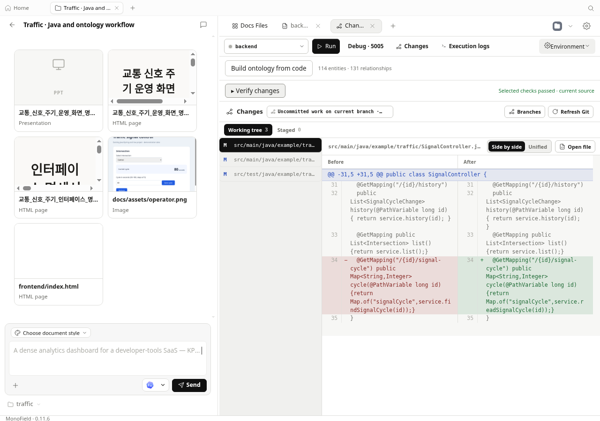

# Java 도구·코드 온톨로지와 검증 연결 — 2026-10-13

MonoField의 개발 작업 공간에 Java 정의·참조 검색, 의미 기반 이름 변경, 실제 JVM 디버깅과 Maven 검사를 추가했다. 기존 코드 온톨로지는 Git 변경, 저장된 API·화면 명세, 실제 검사 기록을 함께 보여주는 계획으로 연결했다. 작은 자사 제작 교통 시스템으로 관찰한 결과이며, LG CNS의 실제 프로젝트나 임직원 사용성 평가를 대신하지 않는다.

## 사용 위치

- Java 파일에서 **Enable Java tools**를 선택한다. 자동완성(Ctrl+Space), 정의·참조·유형 조회, 이름 변경 미리보기와 적용을 제공한다. JDK 21 이상과 Maven 환경이 필요하다. 첫 사용에 공식 Red Hat Java 확장 1.56.0의 Eclipse 서버 약 54 MB를 SHA-256 검증 후 설치한다. EPL-2.0과 확장에 포함된 서버 라이선스를 보존한다.
- 실행 바의 **Debug · 5005**로 Maven Spring Boot 앱을 실행하고 **Java debugger**에서 연결한다. 실제 중단점, 스택, 현재 프레임 변수, 한 줄 실행과 계속 실행을 제공한다. 루프백 주소에 연결하며 임의 평가 명령은 받지 않는다.
- **Changes → Verify changes**에서 발견된 Maven test/test-compile/package/dependency 준비 명령을 선택한다. 전체 코드 폴더의 하위 모듈 검사도 해당 모듈에서 실행한다.
- **Changes → Build ontology from code → Build code and document change plan**으로 코드·Git·명세·검사를 연결한다. 전체 폴더 분석과 저장 후 자동 갱신은 선택 사항이다. 자동 갱신은 패널이 열려 있고 에이전트가 실행 중이지 않을 때만 작동한다.

서버 준비 알림은 편집 중인 탭을 유지한다. 내장 브라우저는 Browser 버튼으로 연다. 문서의 DB·의존성 제어는 접힌 패널 안에 있으며 닫힌 패널은 상태를 주기적으로 요청하지 않는다.

## 실제 관찰

| 검증 | 결과 |
| --- | --- |
| Java 정의·참조 | 정의 1곳, 참조 3곳: 서비스·컨트롤러·테스트 |
| 의미 기반 이름 변경 | 호출부가 포함된 3개 Java 파일 변경; 미리보기 후 다른 수정이 들어오면 HTTP 409로 적용 거부 |
| Maven | JUnit 4개 및 test-compile 통과; 검사 도중 소스가 같았다는 기록 보존 |
| JVM 디버깅 | 실제 Spring 요청에서 34행 중단, `id = 1`, 스택 확인; 35행으로 이동 후 계속 실행하여 HTTP 200·signalCycle 60 확인 |
| 디버거 분리 | 분리 후에도 실제 서버 요청 HTTP 200 |
| 분석 격리 | 분석·편집기 오류 진단 전후 원본 `.class` 9개의 SHA-256 동일; Maven 검사도 통과 |
| 자동 종료·복구 | 약 126초 관찰 중 서버 종료 확인; 참조 검색으로 약 5.1초 후 다시 시작, 같은 참조 3곳 반환 |
| 명세 없는 코드 추출 | Java 9, Vue 1, TypeScript 2 파일; 업무 문서 없이 엔터티 114개·관계 131개, 모델 호출 0 |
| 코드와 명세 계획 | 영향 15개, 검사 통과로 인정된 의무 19개, 남은 의무 23개, 커버리지 공백 15개; API 4건·화면 1건 재검토 표시 |

Java 서버가 준비 신호를 먼저 보내고 Maven 인덱싱을 나중에 끝내는 동작을 발견했다. 실제 클래스패스를 확인한 뒤 준비 완료를 표시하도록 수정했다. Eclipse 초기 빌드가 Maven 산출물을 덮어써 Spring 인자 메타데이터를 없애는 충돌도 실제 테스트에서 재현됐다. 자동 빌드 설정만으로 해결되지 않아, 분석용 코드·POM과 컴파일 산출물을 별도의 로컬 작업 사본에 격리했다. 실제 수정은 원본 해시를 확인한 뒤 적용하고, Maven 실행과 디버깅은 원본 프로젝트를 사용한다. 데이터 경계는 [AGENTS.md의 데이터 디렉터리 계약](../../AGENTS.md#daemon-data-directory-contract)을 따른다.

## 메모리와 반응

Linux 가상 화면의 실제 Electron, 배포용 웹 빌드, tools-dev daemon을 사용했다. PSS는 공유 메모리를 배분한 합계이며 Windows 설치본의 측정값이 아니다. 서버·JDK·브라우저를 합친 일반적인 장시간 사용량이나 대규모 저장소의 상한도 아니다.

| 관찰 상태 | 앱 프로세스 합계 PSS |
| --- | ---: |
| Java 분석 종료 | 약 676 MiB |
| 초기 구현의 Java 분석 사용 | 약 1,516 MiB |
| 격리·JVM 설정 조정 후 참조 검색 10회·이름 변경 미리보기 | 약 1,046 MiB |

따뜻한 참조 검색은 초기 구현의 약 0.09초에서 최종 격리 구현의 약 0.20초로 늘었다. 자동 종료 후 첫 요청에는 약 5초가 필요했다. 원본 빌드 보호와 메모리 감소를 얻었지만 모든 응답 시간이 개선됐다고 주장하지 않는다. 순차 측정이므로 캐시·프로세스 준비 상태의 영향도 있다. 개발 웹 컴파일러가 포함된 약 3.1 GiB 관찰값은 배포용 앱 사용량과 분리했다.

## 캡처

원본 PNG를 보존했다. 실제 버튼과 키보드로 조작하고 API·컴파일 해시로 확인했다. 캡처의 버전 0.11.6은 저장소 버전이며 이 기능을 포함한 새 Windows 설치본 배포를 의미하지 않는다.

## CLI와 한계

2026-10-15 추가 작업으로 그래프 탐색을 MIT 라이선스의 Graphology에 통합했다.
별도 서버·계정·사용자 설치는 필요하지 않다. 코드 의미 추출과 그래프 엔진의
역할을 구분하며, 불확실한 정적 연결과 수동 검토는 그대로 남긴다.
[후보 비교·선정 이유·측정 범위](../ontology-graph-engine.md)에 자세히 기록했다.
실제 변경 그래프(23노드·32관계)의 영향 경로는 이전 구현과 같았다. 순수 그래프
계산 중앙값은 약 0.01ms에서 0.10ms로 증가했으므로 속도 개선이라고 주장하지
않는다. 라이브러리 파일은 압축 전 약 3.2MiB이며 추가 상주 프로세스는 없다.

UI와 CLI는 같은 API를 사용한다. `monofield java`의 start/stop/status/prepare/preparation, completion/definition/references/hover, rename-preview/rename-apply, debug-launch/debug-attach/debug-command/debug-stop/debug-status를 제공한다. `--project`, `--file`, `--json`을 사용하며 의미 조회 위치는 0부터, 디버그 행·프레임은 1부터 센다. `monofield docs plan-code --project ID --project-path . --json`은 통합 계획을 조회한다. 코드 분석에 AI 키나 Laya/JEV 서버는 필요하지 않다.

기본 온톨로지는 로컬 기술 관계 그래프다. 명세 없이 구축할 수 있지만 비즈니스 의미·실제 DB·실행 권한을 자동 확정하지 않는다. 파일 단위 전파이므로 같은 컨트롤러의 변경하지 않은 API도 보수적으로 재검토 대상이 될 수 있다. 명세를 자동 덮어쓰지 않으며 연결이 없거나 지원하지 않는 구문은 미확인으로 남긴다. 검사 통과가 항목별 단언의 커버리지나 브라우저·키보드·반응형 검토를 대신하지 않는다.

Java는 Maven 프로젝트와 작은 실제 예제로 검증했다. Gradle, 조건부 중단점, 객체의 깊은 탐색, 대규모 모듈·고급 리팩터링, Windows에서의 전체 Java 흐름은 별도 검증이 필요하다. 작업 사본은 Java·POM·일부 IDE 설정을 복사하며 10,000개 파일·64 MiB 한도가 있다. 기타 언어 IDE 기능, 실제 임직원 채택, Codex/Claude와의 최신 동일 조건 작업 시간 비교는 입증하지 않았다.

소스 검증은 daemon 관련 111개, web 관련 61개 통과, 기존 플랫폼 조건에 따른 6개 건너뜀, guard 67개, 저장소 typecheck와 daemon/web 빌드를 포함한다. Nix가 로컬에 없어 의존성 해시 검사는 PR의 Validate workspace/Nix 게이트에서 확인해야 한다. 기존 원격 CI에도 실패가 남아 있어 저장소 전체 CI 통과를 주장하지 않는다. 검사 기록·진단 로그·인증 자료를 소스에 올리지 않았으며 이 문서와 자사 제작 예제의 선정된 화면만 공개 증거로 포함한다.
