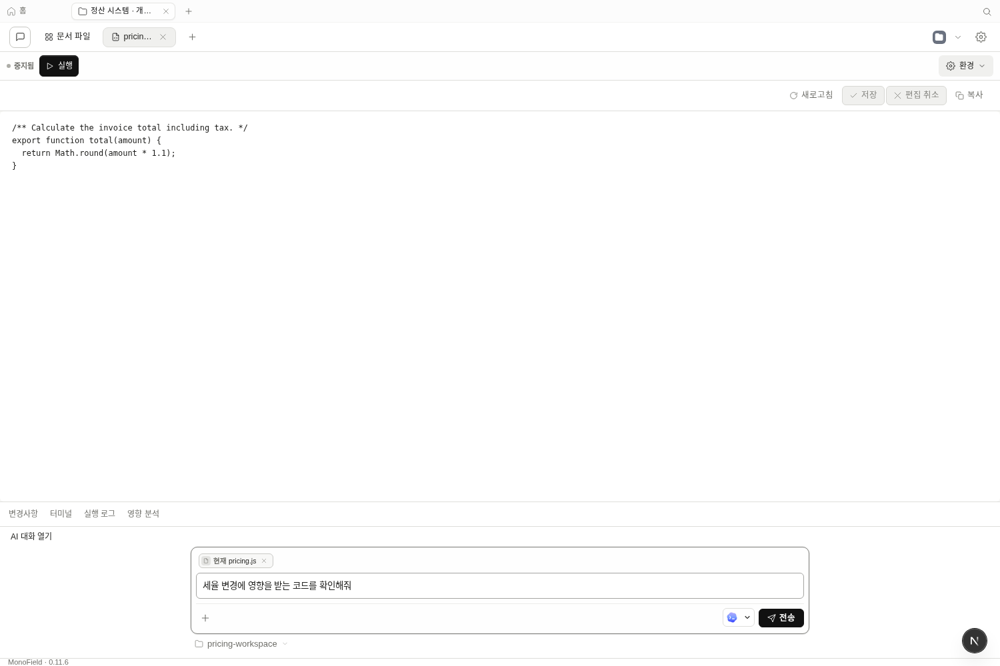
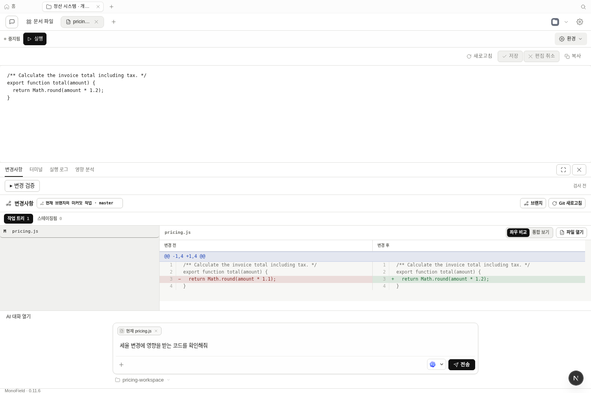
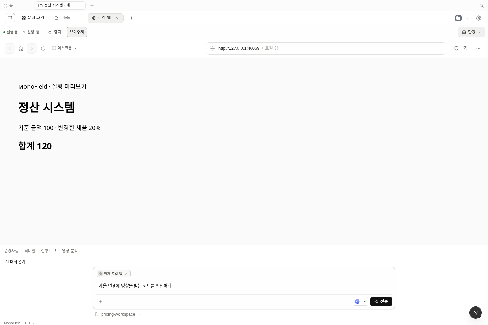

# 편집기 중심 개발 작업공간 — 2026-10-18

개발 모드의 기본 화면을 코드·실행 화면 중심으로 바꿨다. 하단에는 짧은 AI 입력창과 작업 도구 탭을 두었다. 아래 이미지는 실제 앱과 daemon을 실행한 Chromium 캡처다.

## 화면 구성

| 영역 | 동작 |
| --- | --- |
| 중앙 | 파일 목록, 코드 편집기, 실행 브라우저를 전환한다. |
| AI | 기본은 짧은 입력창이다. 대화를 열거나 요청을 보내면 대화 내역을 펼친다. 접어도 초안을 유지한다. |
| 하단 도구 | 변경사항·터미널·실행 로그·영향 분석 중 하나를 표시한다. 닫기·확대·축소와 키보드 탭 탐색을 제공한다. |
| 상태 유지 | 처음 사용한 도구의 결과·세션을 유지한다. 닫거나 전환한다고 터미널을 종료하지 않는다. 여러 터미널은 도구 안에서 선택한다. |
| 영향 분석 | 변경사항 위에 쌓지 않고 전용 탭에서 연다. 분석 시 열린 소스에 대응하는 대상을 우선 선택한다. |

[이전 배치 캡처](evidence/ontology-ui-2026-10-18/select-source.png). 전후 이미지는 서로 다른 예제 프로젝트이며 동일 작업의 시간·메모리 비교는 아니다.

[터미널 실행](evidence/development-workspace-2026-10-18/editor-and-terminal.png) · [서버 실행 로그](evidence/development-workspace-2026-10-18/editor-and-run-logs.png) · [1000×800 화면](evidence/development-workspace-2026-10-18/narrow-workspace.png)

## 실제 작업 검증

`e2e/ui/development-focus.test.ts`는 기존 Git 저장소가 있는 Node.js 정산 예제를 실제 폴더 가져오기로 등록한다. 다음 동작을 UI로 수행한다.

1. `pricing.js`를 열고 AI 요청 초안을 입력한다. 긴 대화와 도구 본문은 기본으로 접혀 있다.
2. 세율을 10%에서 20%로 변경하고, 저장 전에 로그·변경사항을 전환해 편집 내용 보존을 확인한다.
3. 저장 후 디스크 원문과 Git diff의 `1.1 → 1.2` 변경을 확인한다.
4. 실제 daemon PTY에서 `node -p '6*7'`을 실행해 `42`를 확인한다. 로그로 전환했다 돌아와도 출력이 남는다.
5. AI 대화를 펼쳤다 접은 뒤 요청 초안이 같은지 확인한다. 요청은 AI에 전송하지 않는다.
6. 앱의 실행 버튼으로 실제 Node 서버를 시작하고 로그를 확인한다. 내장 브라우저에서 변경된 계산 결과 `합계 120`을 확인한다.
7. 1000×800에서도 가로 넘침이 없는지 확인하고 서버를 종료한다.

자동 AI 화면 검증은 이 예제에서 끈다. 이 검증은 외부 AI 모델의 개발 품질이나 Java/Spring 서버 실행을 측정한 것이 아니다. 별도 Java/Spring + Vue 온톨로지 흐름 2개와 실패→수정→통과→증거 무효화의 변경 검증 흐름 1개도 새 배치에서 통과했다.

## 발견·수정한 문제

- 대화를 펼칠 때 입력창이 포털로 이동하며 다시 생성되어 요청 초안이 사라졌다. 개발 모드에서는 동일한 부모 아래 입력창을 유지한다. 온톨로지의 요청 초안 전달과 대화 접기·펼치기를 실제 브라우저에서 확인했다.
- 편집기와 함께 열린 diff는 저장 후에도 이전 상태를 표시했다. 저장 완료 시 소스 버전을 갱신하고, 열린 변경사항은 daemon의 15초 Git 읽기 캐시를 새로 읽는다. 접힌 도구는 Git 상태·diff를 새로 요청하지 않는다. 캐시를 재현한 회귀 테스트가 수정 전 실패하고 수정 후 통과했다. 이 실패는 이번 변경 작업 중 상태에서 재현한 것이며 main 전체에 대한 주장으로 확대하지 않는다.
- 활성 파일용 입력창 최소 높이가 작은 AI 입력창에도 적용되어 전송 버튼이 잘렸다. 접힌 대화의 입력 높이를 제한하고, 중복 파일 안내를 줄였다.

## 검증 결과와 범위

- 컴포넌트 검사 109개 / 6개 파일 통과 후 다중 터미널 복원 검사 1개를 추가해 별도 통과했다. 총 110개 고유 검사이며 재실행을 중복 합산하지 않았다. 마지막 Git 캐시 수정 뒤에는 `GitChangesPanel.test.tsx` 10개를 재실행해 통과했다.
- 실제 daemon + Chromium 흐름 4개 통과. 온톨로지 2개와 변경 검증 1개를 함께 실행했고, 마지막 Git 캐시 수정 후 정산 작업 흐름을 별도로 재실행해 통과했다.
- `pnpm guard` 67개, 전체 `pnpm typecheck`, 최종 웹 타입 검사 및 프로덕션 빌드 통과.
- 새 의존성·모델 서버·API·CLI 명령은 추가하지 않았다. 기존 기능의 UI 배치·상태 유지·저장 후 갱신 변경이다.

실제 CPU·메모리 절감, 장기간 사용성, 기존 도구 대비 완료 시간 우위는 이번 검증 범위에 없다. Windows 설치본과 업데이트 피드 배포도 포함하지 않는다. 원시 오류·인증·실행 로그는 Git에 넣지 않고 기능 코드와 위 캡처만 남겼다.
