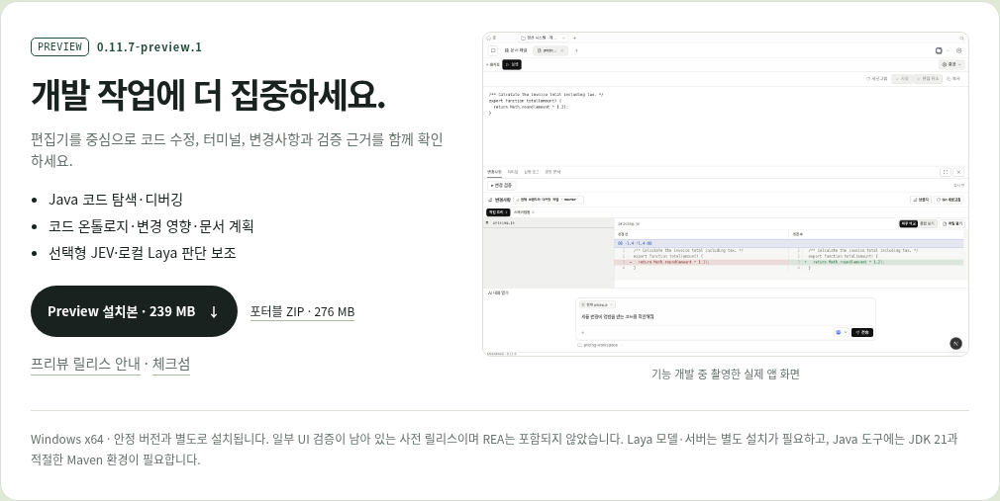
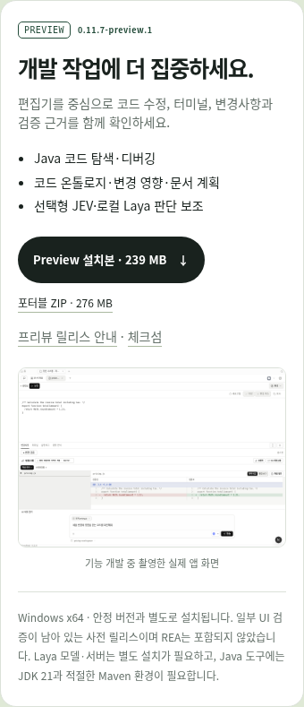

# Published preview on the MonoField landing page

The landing page presents the public `0.11.7-preview.1` Windows release with
installer, portable ZIP, checksums and release notes. The existing stable cards
continue to follow the stable release API. Development copy covers the focused
editor, Java tools, ontology and optional local Laya support; it discloses REA
exclusion, incomplete UI validation and external model/tool prerequisites.

## Browser verification

Actual static site in Chromium, at 1440 × 1000 and 390 × 844. The public stable
GitHub release response was captured and served to the browser to exercise its
normal download updater without depending on browser network routing.

- Preview URLs remain pinned to the published preview after the stable response
  loads and after Korean/English switching. Stable installer URLs select 0.11.6.
- Both viewport sizes have no horizontal overflow or browser page errors.
- The actual app capture loads, enlarges and closes with Escape.
- The mobile menu opens and closes when a navigation link is selected.
- Existing SEO tests: seven passed. Site script/type syntax checks passed.
- Repository policy checks: 67 passed. `git diff --check` passed.

