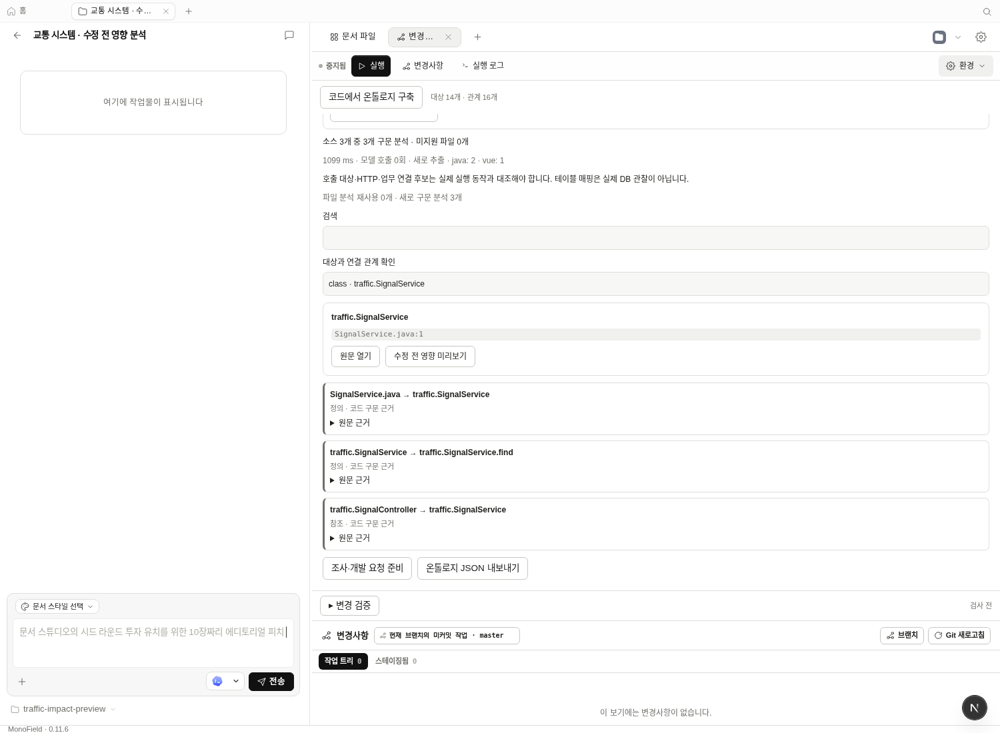
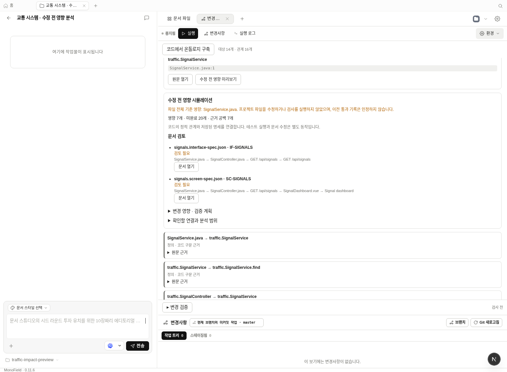
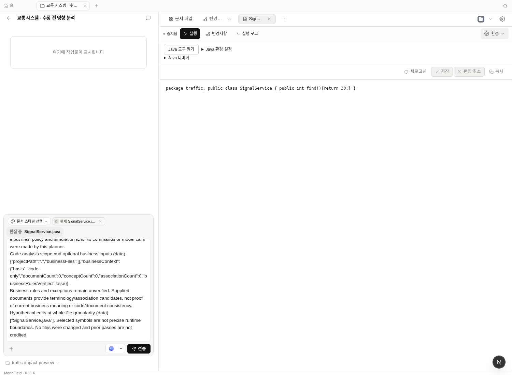

# 수정 전 영향 미리보기·로컬 판단 개선 검증

2026-10-17. 기존 온톨로지 구축·문서 영향·검사 기능을 다시 대조하고, 구축한
관계를 실제 수정 전의 개발 판단에 쓰는 흐름을 추가했다. Linux / Node 24.19 /
pnpm 10.33.2이며 자사 제작 예제다. 고객 프로젝트·Windows 설치본 검증은 아니다.

## 개선한 작업 흐름

**변경사항 → 코드에서 온톨로지 구축**으로 분석한 뒤 서비스·메서드·API·화면을
선택하고 **수정 전 영향 미리보기**를 누른다. 선택 항목이 있는 파일을 가상 변경
대상으로 삼아 연결된 소비자, 검토할 명세, 필요한 검사·수동 검토를 표시한다.
Git 변경이 없어도 사용할 수 있다. 원문과 관련 명세를 기존 편집기로 바로 연다.

이 경로는 기존 코드 파서·Graphology·선언형 조건 규칙·문서 연결을 재사용한다.
별도 DB·추가 모델·패키지를 설치하지 않는다. 실제 프로젝트 파일이나 DB를
수정하지 않고 검사 명령도 실행하지 않는다. 메서드 선택도 **파일 전체**로
보수적으로 확장한다. 정확한 메서드별 런타임 영향 분석으로 표시하지 않는다.

예제의 `SignalService` 선택 결과:

`SignalService.java → SignalController.java → GET /api/signals → SignalDashboard.vue → 화면 명세`

API 명세도 같은 출처 API와 연결된다. Git 작업 트리가 깨끗한 상태에서 영향 대상
7개, 검증 의무 20개, 미완료 20개, 커버리지 공백 7개를 반환했다. 가상 변경이므로
이전 통과 기록은 인정하지 않아 통과는 0개였다. API `IF-SIGNALS`, 화면
`SC-SIGNALS` 모두 검토 대상으로 표시됐다. 구축·계획의 모델 호출은 0회였다.
소스 원문과 `git status --porcelain`이 실행 전후 그대로임을 확인했다.







모두 실제 Chromium과 production daemon API의 화면이다. 기존 예시 튜토리얼
화면을 실제 분석 결과로 대체한 것이 아니다. 이번 브라우저 흐름은 AI에 변경을
전송하거나 Java 서버를 실행하지 않았고, 계획 준비·출처 탐색을 검증했다.

## API·CLI와 경계

`POST /api/projects/:id/ontology/plan`의 `simulateFiles`는 가져온 작업 공간 기준
소스 경로 1–32개를 받는다. 하위 모듈 분석에서도 경로는 작업 공간 기준이다.
현재 분석 범위의 파일만 허용하며 빈 배열·상위 경로·없는 파일·업무 문서·다른
모듈 소스를 거부한다. 결과의 `simulation`은 대상과 `granularity: "file"`을 담는다.

```sh
monofield docs plan-code --project PROJECT_ID --project-path . --simulate-file source-paths.json --prompt-file change.txt --json
```

같은 API를 사용하며 stdin·32 KiB·단일 입력 제한을 유지한다. 기존 `docs plan`의
명세 노드 ID 기반 시뮬레이션은 유지한다. UI의 원문 열기는 모듈 접두사를 포함한
경로를 사용한다. 소스가 변경된 보고서는 재구축 전 시뮬레이션을 막는다.

## 재현했던 Laya 연동 결함 수정

1. **확인한 backend 고정:** `evaluateJev`가 전달된 설정을 무시하고 다시 파일을
   읽던 동작을 수정했다. 로컬 확인 직후 저장 설정을 hosted로 바꿔도 확인한
   루프백 URL로 전송한다. 실제 전송 함수에 가짜 키·가로챈 fetch를 사용해
   수정 전 hosted URL, 수정 후 local URL을 확인했다. 외부 전송은 하지 않았다.
2. **설정 읽기에도 제한 시간 적용:** 근거 후보 순서 보조는 설정 조회부터
   취소·시간 제한을 적용한다. 설정 읽기를 정지시키면 제한 시간 후 평가 시도
   0회로 fallback한다. 수정 전에는 제한 15ms에서 150ms 관찰 후에도 미완료였다.
3. **검사 추천 재사용:** 같은 소스·검사 목록·질문·backend/model의 성공 응답을
   5분간 최대 64건 재사용한다. NONE/불확실 응답도 포함하며 통신 실패는 제외한다.
   캐시에서도 전후 소스 검증을 유지한다. 새 평가 0회·`cached: true`·이번 사용량
   `null`로 표시하며 이전 토큰을 다시 사용한 양으로 표시하지 않는다.

첫 두 결함은 수정 전 커밋 `d02b34d4`에서 실패하는 테스트를 먼저 실행하고,
수정 후 통과를 확인했다. 기능이 없던 main에서 모두 같은 방식으로 재현됐다는
주장은 하지 않는다. Laya의 추천 확률 기준을 낮추거나 품질 향상을 주장하지 않는다.

## 실제 HTTP·모델 반복 측정

production daemon/web을 격리된 tools-dev 런타임으로 시작했다. 실제 Git 저장소의
Git 추적 파일 2개와 test/build 카탈로그를 사용했다. 소스/카탈로그 수집을
가짜 함수로 바꾸지 않고 실제 추천 HTTP API를 호출했다. Laya 0.3.28 multilingual,
CPU 2스레드, revision `55cf4c4ebb4ebe31b2550e8bdf3bd21b99753851`을 로컬에서 실행했다.

| 요청 | 첫 HTTP 응답 | 동일 요청 반복 | 새 평가: 첫/반복 | 서버 보고 입력/출력: 첫 |
| --- | ---: | ---: | --- | --- |
| 로그인 함수 반환 값 수정 | 655.67ms | 21.72ms | 1 / 0 | 400 / 0 |
| 버튼 대비·반응형 변경 | 702.84ms | 28.00ms | 1 / 0 | 415 / 0 |

반복 응답의 사용량은 `null`이었다. 앱 요청 4회 중 모델 서버의 실제 POST는 2회
증가했다. Git 상태도 깨끗하게 유지됐다. 각각 한 번씩 순서대로 관측한 작은
예제이며, 첫 요청과 캐시 적중의 비용 비교다. 이전 버전과 통제된 전체 개발
작업을 비교한 결과나 일반적인 20배 생산성 개선으로 해석하지 않는다.

모델은 두 요청 모두 NONE을 반환했다. 이 측정이 입증하는 것은 **같은 판단의
재호출 비용 감소**이며 추천 품질 향상이 아니다. 기본 규칙 추천과 온톨로지
구축·영향 분석은 계속 모델 없이 동작한다. 검증 후 앱 런타임과 모델 서버는 종료했다.

## 검증 결과

- daemon 관련 93개 / 9파일 통과. 설정 고정, 중단된 설정 조회, 캐시 재사용과
  소스·카탈로그·모델 변경 시 무효화, 범위 검증, API/CLI 시뮬레이션을 포함한다.
- web 관련 29개 / 4파일 통과. 모듈 경로 원문 열기, 영향 미리보기, 오래된 소스
  차단, 명세 열기, 캐시 사용량 표시, 기존 Git/근거 선택 흐름을 포함한다.
- 실제 daemon + Chromium 시나리오 2개 통과. 기존 구축·선택 문서 흐름과 새
  수정 전 미리보기·초안·편집기 열기를 확인했다. 전체 실행 약 1.2분.
- frozen-lockfile install, 전체 workspace typecheck, guard 67개, daemon build,
  production web build 통과. 신규 의존성·lockfile 변경은 없다.

전체 원격 CI의 이전 실패들은 이번 로컬 통과로 해결됐다고 보지 않는다.
새 Windows 설치본·릴리스·업데이트 피드에는 별도 반영이 필요하다. 자동 업무
의미 검증, 모든 언어 지원, 고객 프로젝트의 장기 사용성과 전체 AI 비용 우위도
이번 결과에 포함하지 않는다.
