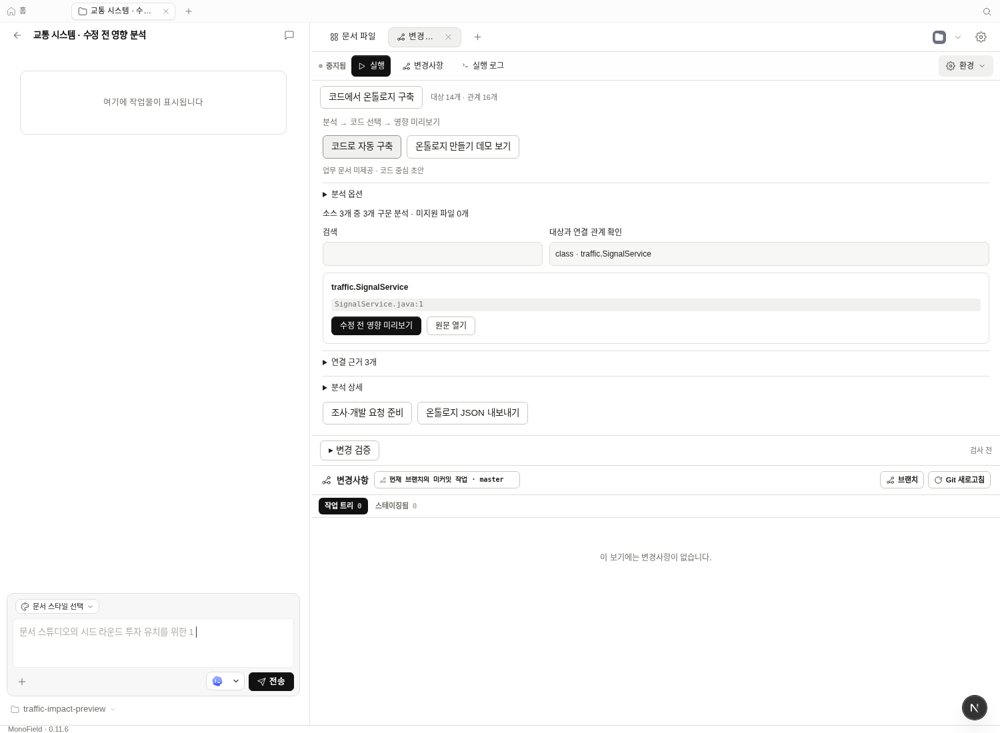
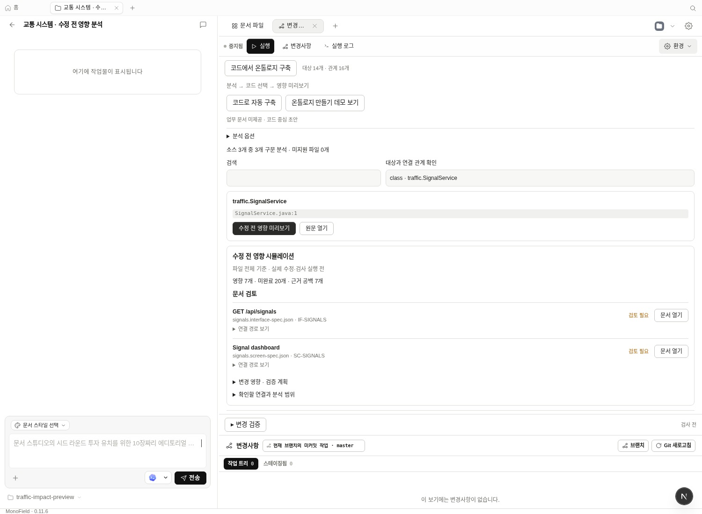

# 온톨로지 화면 단순화 — 2026-10-18

기본 흐름을 **분석 → 코드 선택 → 영향 미리보기**로 정리했다. 실제 MonoField 웹 UI와 운영 코드의 daemon API로 Java/Spring + Vue 예제 저장소를 열어 캡처했다. 디자인 시안이나 실행 결과를 합성한 이미지가 아니다. Windows 설치본에 배포한 결과는 아니다.

## 변경 전후

기존 화면은 문서 경로, 조사 주제, 자동 갱신, 전체 코드베이스 범위, 긴 안내 문구, 원시 관계 목록을 함께 표시했다. 이제 선택 입력은 **분석 옵션**, 캐시·분석 범위 설명은 **분석 상세**, 원시 관계는 **연결 근거**에서 펼친다. 미지원 파일 수, 문서 미제공 상태, 문서 후보의 미검증 상태, 소스 변경 후 재분석 필요 여부는 계속 표시한다.

[변경 전 코드 선택](evidence/ontology-impact-2026-10-17/select-source.png) · [변경 전 영향 결과](evidence/ontology-impact-2026-10-17/impact-preview.png)

영향 결과는 읽을 수 있는 API·화면 이름, 검토 상태, 문서 열기를 먼저 표시한다. 파일 경로와 항목 ID는 보조 정보로 남기고 긴 연결 경로와 개별 검증 의무는 접어둔다. 파일 전체 기준의 미리보기이며 실제 수정·검사를 실행하기 전이라는 설명은 결과에 남아 있다.

[기존 편집기에서 실제 원문 열기](evidence/ontology-ui-2026-10-18/open-source.png)

## 검증

- `pnpm --filter @open-design/web exec vitest run tests/components/CodeOntologyPanel.test.tsx tests/components/OntologyContextPanel.test.tsx tests/components/OntologyTutorial.test.tsx tests/components/GitChangesPanel.test.tsx` — 27개 통과. 기본 접힘, 펼치기만으로 요청이 생기지 않음, 기존 자동 갱신·원문 열기·명세 연결 동작을 포함한다.
- `pnpm --filter @open-design/e2e exec playwright test -c playwright.config.ts ui/code-ontology.test.ts --workers=1` — 실제 앱 흐름 2개 통과. 선택 입력은 옵션을 펼친 뒤 조작하며, 기본 접힘을 실제 브라우저에서 확인한다. 튜토리얼, 문서 추가, 캐시 재사용, JSON 내보내기, AI 근거 초안, 수정 전 영향 미리보기, 원문 편집기 진입을 포함한다.
- 서비스 파일 미리보기 결과: 영향 대상 7개, 미완료 의무 20개, 근거 공백 7개. 이전 통과 인정 0개, 모델 호출 0회. 서비스 원문 바이트와 Git 작업 트리는 변하지 않았다. 실제 업무 규칙 검증 통과를 뜻하지 않는다.
- `pnpm guard` — 67개 통과. 전체 `pnpm typecheck`와 웹 프로덕션 빌드 통과.

새 API·CLI 기능이나 의존성을 추가하지 않았다. 기존 기능의 표시 순서와 기본 펼침 상태를 변경했다. 이번 UI 변경은 체감 속도·메모리 개선이나 장기 사용성 우위를 측정한 결과가 아니다. 캡처·검증은 개발 환경 Chromium에서 수행했으며 설치본·업데이트 피드 배포는 포함하지 않는다.
