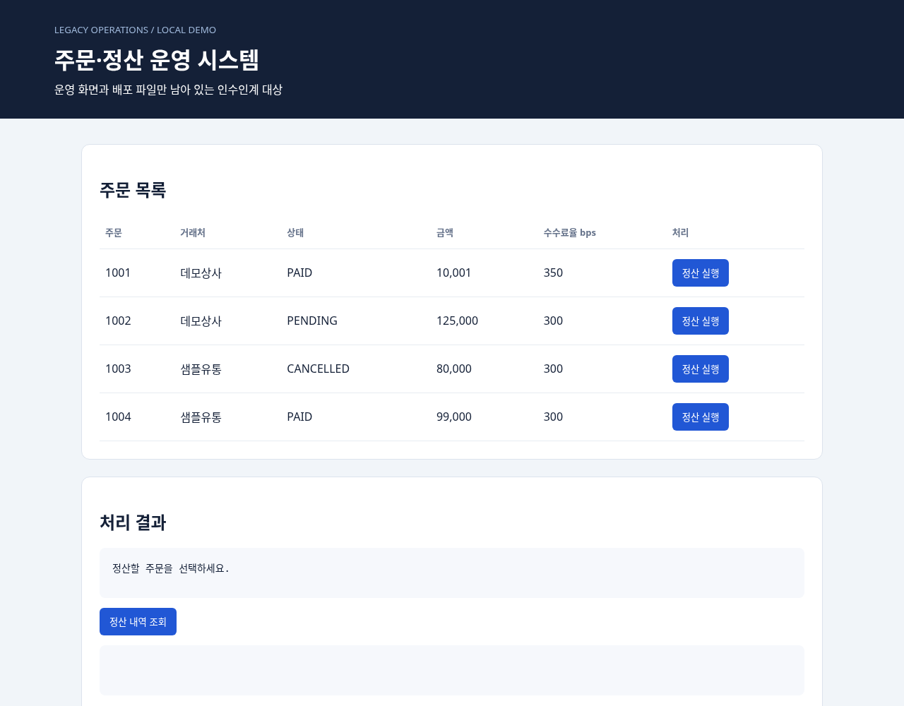

# REA + MonoField SI 인수인계 실제 실행 · 2026-10-22

REA로 합성 주문·정산 앱의 JavaScript 배포물·Chromium 화면·SQLite를 조사하고, agent가 근거를 정리해 MonoField 문서 CLI로 **API 3개 Excel 명세서와 화면명세서 PPTX 2장**을 출력했다. 새 디렉터리에서 재현 실행도 통과했다. 고객 시스템 사례나 blind benchmark는 아니다. Laya는 이 데모에서 호출하지 않았다.

[전체 원본 근거·Excel·PPTX·재현 코드 ZIP](evidence/rea-handover-2026-10-22/rea-si-handover-20261022.zip) · [저장소의 재현 예제](../examples/rea-si-handover/README.md) · [새 REA MCP 설정과 Laya 가이드](../rea-laya-handover.md)

## 실제 확인한 업무 흐름

| 화면에서 한 작업 | 관찰한 통신·결과 | 근거 |
|---|---|---|
| 주문 목록 열기 | `GET /api/orders` → 200, 주문 4건 | B: `orders-loaded`, response sequence 12 / body 15 |
| PAID 주문 1001 정산 | `POST /api/orders/1001/settle`, `{}` → 201. 금액 10,001 / 수수료 351 / 지급액 9,650 | B: `paid-settlement-result`, response 18 / body 20 |
| 같은 주문 재정산 | 409, `ALREADY_SETTLED` | B: `duplicate-settlement-result`, response 23 / body 25 |
| PENDING 주문 1002 정산 | 409, `ORDER_NOT_PAID`, PENDING | B: `pending-rejected-result`, response 28 / body 30 |
| CANCELLED 주문 1003 정산 | 409, `ORDER_NOT_PAID`, CANCELLED | B: `cancelled-rejected-result`, response 33 / body 35 |
| 정산 내역 조회 | `GET /api/settlements` → 200, 주문 1001 정산 1건 | B: `settlements-loaded`, response 38 / body 40 |

선언한 브라우저 action 11개가 모두 `completed`다. 정상·중복·미결제·취소의 결과는 **DOM에 표시된 JSON과 응답 본문을 별도로 대조해 일치**를 확인했다. 캡처한 API 응답 바이트의 SHA-256도 검사했다. 응답 바이트는 Playwright API가 제공한 표현이며 원래 전송된 wire bytes를 증명하지 않는다.

실행 후 쓰기가 멈춘 상태에서 REA SQLite 검사로 확인했다.

- S의 `normalized_result.rows`: 주문 1001 정산 **1건**, 금액 10001 / 수수료 351 / 지급액 9650.
- A의 같은 위치: `SETTLE_ORDER` 감사 로그 **1건**, 주문 1001 및 정산 ID·수수료·지급액 일치.
- D의 `normalized_result.schema`: `customers`, `orders`, `settlements`, `audit_log` 4개 테이블. orders→customers, settlements→orders, audit_log→orders FK 선언. `settlements.order_id` UNIQUE. 상태·금액·수수료율 CHECK 선언. 해당 스냅샷에는 view·trigger 없음.

FK 선언 자체가 실행 연결의 FK 강제를 증명하지는 않는다. 초기 D는 스키마 검사이며 행이 없으므로 이것만으로 변경 전후 행 비교를 주장하지 않는다.

## 해석과 미확인 사항

| 인수인계 질문 | 상태 | 결론·경계 |
|---|---|---|
| 화면에서 어떤 API를 사용하는가? | 관찰 완료 | 실제 사용한 GET 2개와 정산 POST 경로를 화면 동작과 연결했다. 전체 API 목록을 복원했다는 뜻은 아니다. |
| 어떤 데이터 구조를 사용하는가? | 관찰 완료 | 4개 테이블의 스키마·제약을 확보했다. 정산·감사 행도 관찰했다. |
| 정상 및 거절 동작은 무엇인가? | 관찰 완료 | 위 4개 주문 처리 사례를 실제 실행했다. |
| 모든 수수료 계산 규칙이 무엇인가? | 부분 확인 | 10001×350/10000의 올림값 351과 관찰이 일치한다. 단일 사례로 전체 올림·세금 규칙을 확정하지 않는다. |
| 동시 정산·장애 rollback·권한·외부 연계는 안전한가? | 미확인 | 해당 시나리오를 실행하지 않았다. |
| 제품 안에서 어떻게 연결되는가? | MCP 연동 추가 | 이 최초 데모는 REA CLI → agent → MonoField docs CLI 경로다. 0.11.7-preview.2에는 REA MCP 프리셋·설정 CLI·인수인계 스킬을 추가했다. 전용 자동 조사 대시보드는 아니다. |

정적 분석 J는 JavaScript 2개를 파싱했고 parse failure는 0이다. 리터럴 fetch `/api/orders`, `/api/settlements`를 소스 위치·파일 digest와 함께 찾았다. 다만 application coverage `complete`와 달리 **semantic coverage는 `unknown`, semantic unknown은 201개**다. 동적 POST 경로는 실행 관찰로 보완했다.

추가로 `ALREADY_SETTLED` 리터럴 feature trace를 요청했으나 `no-match`였다(T). 이것은 기능 부재의 근거가 아니며 브라우저에서는 해당 응답이 실제 관찰됐다. 전체 업무 흐름을 정적 그래프만으로 자동 복원했다고 주장할 수 없다.

B의 전체 completeness는 **`incomplete`, missing_sections=`["events"]`, equality_eligible=false**다. 선택한 GET 요청 body가 `not_exposed`인 경우가 있다. 개별 응답 본문·DOM 관찰은 확보했지만 전체 이벤트 완전성·동등성은 주장하지 않는다. 전체 화면용 별도 O는 요청한 DOM·스크린샷 범위에서 complete다.

응답 필드의 필수 여부는 관찰로 확정할 수 없어 **18개를 TBD**로 유지했다. MonoField의 해당 경고도 보존했다. 문서의 한글 설명·경로 일반화·콜아웃은 agent가 작성한 검토용 초안이며 REA 자체가 완성 명세를 자동 생성한 것은 아니다.

## 버전과 근거

- 데모 REA: 사용자님의 `rea-yj` commit `bb540826d65316c164d2de8ba4ef10f81a8ad073`, package 6.4.0.
- Node 24.19.0, Chromium 151.0.7922.173. SQLite 스키마와 행 검사는 실제 REA CLI 결과다.
- MonoField contracts/daemon 빌드 후 기존 문서 CLI export 4개 성공. XLSX/PPTX ZIP CRC·XML, 시트·슬라이드·이미지 검사와 생성 HTML의 Chromium 렌더링을 확인했다. Excel/PowerPoint 데스크톱 앱 실행은 검증하지 않았다.
- 초기 DB 파일 자체는 별도 보관하지 않았으며 초기 스키마 REA 근거를 보관했다. 재현 실행기는 변경 전 DB 파일도 보관한다.

## 원본 근거 식별자

| 약자 | 파일 / Evidence ID |
|---|---|
| J | `evidence/static.json` / `ev_872f0d72bbd9657d10d2b8d7359450d90b4d97d2f1bf03a3a942c405c2dee987` |
| 요약 | `evidence/static-summary.json` / `ev_6a41946006f66d308fba26e15493c4cbe6ab37dbf4f429314292ca1c5a2df180` |
| D | `evidence/db-before.json` / `ev_527871f72fb3d0467051a2af26ca5745513a9096ff185322efb7ab070dd5d3e5` |
| B | `evidence/browser.json` / `ev_afc703c94e56d48b45857bef4d39a8439cd8e9a5a0dc91e5491f82879f874eed` |
| O | `evidence/browser-overview.json` / `ev_ef21bc4cf8fecf0adeaf2cbf2fe7737360ce3c3bb735090b3060865e878b7995` |
| S | `evidence/db-settlements.json` / `ev_0e02317cb3470ad6bb0d8708ee6b418b5e5a6bd97f5ff928193ee756e888f232` |
| A | `evidence/db-audit.json` / `ev_05dbd5767de75c78145bf8af366803571a12befb470758d97712415e3fd22940` |
| T | `evidence/duplicate-trace.json` / `ev_b5952a4f1b57d129edac8a3c220395f41ab4f182dcb061333e32eb297a651668` |

정적 분석 시 배포물 digest는 `e1c0e057319c1ba85cdf39641a86aa5588cfc13873fee0b0ecb357259eeef6a8`다. 초기 DB digest는 `7c1d35d39f0a450d40eabfc2fcab9be4a1e1fd15e0de5b7434d787b505622489`, 실행 후 DB는 `671760d5beb5a89726a20012da42418926d01b75ab15d26a5ad0c8e2891b6dd5`다. DB 변경으로 디렉터리 전체 digest도 바뀐다. `shipped-legacy/`에는 실행 후 DB를 남겼다. 초기 실행의 DB 파일 자체는 별도 보관하지 않았고, 재현 실행기는 변경 전 DB 파일도 보관한다.
