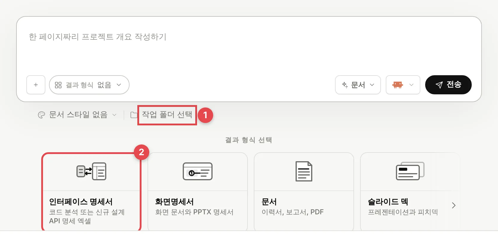
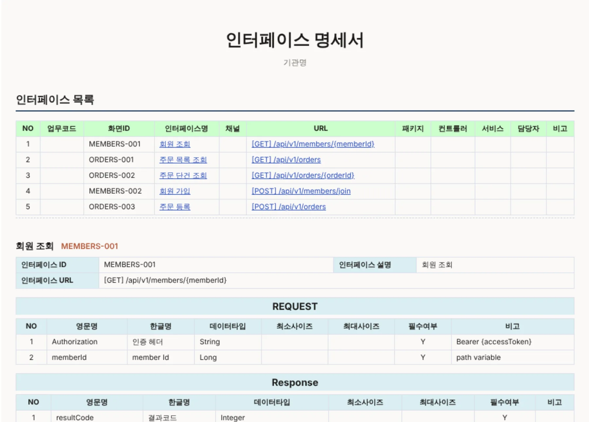
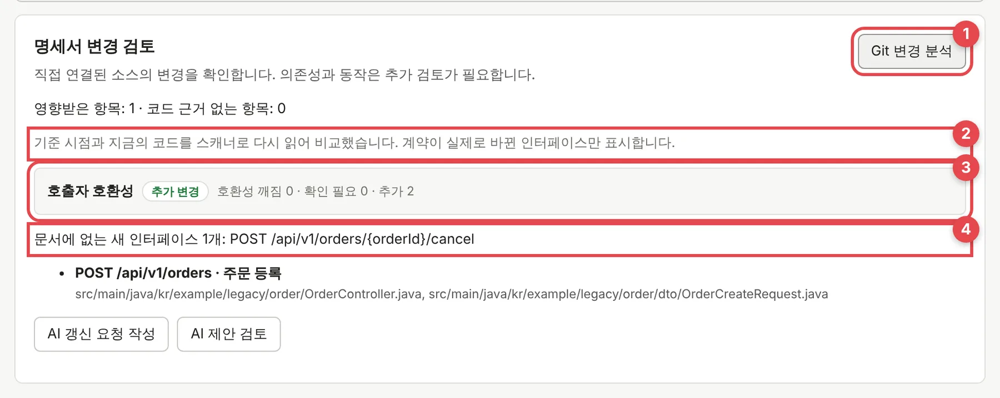
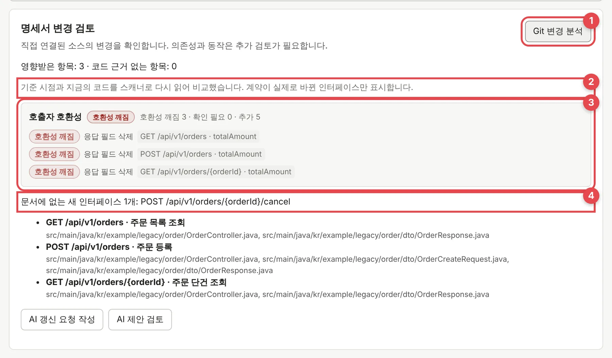

# MonoField 사용 가이드

0.11.7-preview.11 기준

MonoField는 Spring 코드를 읽어 인터페이스 명세서를 만들어 줘요. 코드가 바뀌면 어느 API가 바뀌었는지, 그 API를 쓰는 화면이나 다른 시스템이 깨지는지도 알려 줘요.

보통 개발자가 돌리고 PM과 팀장은 결과만 봐요. 이 가이드도 그렇게 둘로 나눴어요.

- [개발자라면](#개발자가-할-일): 예제 프로젝트 하나로 처음부터 끝까지 따라 해요. 30분쯤 걸려요.
- [PM·팀장이라면](#pm팀장이-볼-것): 받은 엑셀과 변경 분석 화면을 읽는 법이에요. 5분이면 돼요.

## 개발자가 할 일

Windows PC에 세 가지만 있으면 돼요. 명령 프롬프트에 괄호 안 명령을 쳤을 때 버전이 나오면 준비가 끝난 거예요.

- Codex 또는 Claude Code (`codex --version` 또는 `claude --version`). 로그인까지 해 두세요.
- Python 3 (`python --version`). 설치 첫 화면에서 **Add python.exe to PATH**를 꼭 체크하세요.
- Git (`git --version`). 설치만 해 두면 돼요.

### 1. 설치

[다운로드](https://monofield.vercel.app/#download)에서 설치 파일을 받아 실행하세요. 아직 코드 서명이 없어서 "Windows의 PC 보호" 창이 뜰 거예요. **추가 정보**를 누르면 실행 버튼이 보여요.

처음 켜면 화면 안내가 나와요. 안내를 마친 뒤 설정(톱니바퀴) → **실행 모드**에 Codex나 Claude Code가 보이는지만 확인하면 돼요.

### 2. 예제 프로젝트 받기

[예제 프로젝트](https://monofield.vercel.app/downloads/monofield-sample-legacy-order.zip)를 받아 압축을 푸세요. 회원 가입과 주문 API 다섯 개가 든 작은 Spring 프로젝트예요.

압축을 푼 `legacy-order` 폴더에서 명령 프롬프트를 열고 아래 세 줄을 치세요. 지금 코드를 기준점으로 저장해 두는 단계예요. 나중에 무엇이 바뀌었는지는 이 기준점과 비교해서 찾아요.

```bat
git init
git add -A
git commit -m "baseline"
```

> `Please tell me who you are`가 나오면 `git config --global user.name "이름"`과 `git config --global user.email "메일"`을 한 번 치고 다시 커밋하세요.

### 3. 명세서 만들기



*홈 화면. ① 작업 폴더 선택 ② 결과 형식의 인터페이스 명세서*

홈에서 ① **작업 폴더 선택**을 눌러 `legacy-order` 폴더를 고르세요. 그다음 ② **인터페이스 명세서**를 누르고 입력창에 이렇게 보내요.

> 선택한 Spring 프로젝트의 Controller를 스캔해서 인터페이스 명세서 Excel을 만들어 줘

오른쪽에 질문이 두 번 나와요. 작성 방식은 **코드베이스에서 생성**을 고르고 용어 사전에는 예제 폴더의 `docs/term-dictionary.csv`를 올리세요. 나머지를 그대로 두고 제출하면 1~2분 뒤 `…interface-spec.json` 파일이 생기면서 명세서 편집기가 열려요.



*편집기의 미리보기. 엑셀로 내보내도 구성이 같아요*

**미리보기**를 누르면 위 화면이 나와요. 같은 내용을 엑셀로 받으려면 **XLSX 내보내기**를 누르세요.

엑셀에는 표지와 인터페이스 목록, API마다 한 장씩인 상세 시트가 들어가요. 각 칸을 어느 파일 몇째 줄에서 읽었는지 적은 근거 시트도 함께 붙어요.

여기까지 됐으면 명세서 파일도 커밋해 두세요(`git add -A`, `git commit -m "명세서 v1.0"`).

### 4. 코드를 바꾸고 바뀐 것만 보기

이번엔 코드를 바꿔 볼게요. 채팅에 이렇게 보내세요.

> 주문 등록에 배송 요청 사항(deliveryMemo)을 추가하고 주문 취소 API를 만들어 줘

AI가 코드를 다 고치면 명세서 편집기에서 ① **Git 변경 분석**을 누르세요. 이 단계는 AI를 쓰지 않아요. 기준점의 코드와 지금 코드를 PC 안에서 다시 읽어 비교하는데 몇 초면 끝나요.



*① 누르는 곳 ② 정밀하게 비교했다는 표시 ③ 호출하는 쪽에 주는 영향 ④ 명세서에 아직 없는 새 API*

예제대로 고쳐졌다면 바뀐 API는 주문 등록 하나예요. 선택 입력 항목이 하나 늘었을 뿐이라 ③에는 **추가 변경**으로 나와요. 새로 생긴 주문 취소 API는 ④에 따로 잡혀요.

### 5. 명세서에 반영하고 보내기

**AI 갱신 요청 작성**을 누르고 전송하면 AI가 바뀐 API만 고친 수정안을 만들어요. **AI 제안 검토**에서 지금 문서와 나란히 놓고 확인한 다음 **검토한 제안 적용**을 누르고 저장하세요. 마지막으로 **XLSX 내보내기**를 누르면 새 엑셀이 나와요.

PM이나 팀장에게는 새 엑셀 파일과 변경 분석 화면 캡처를 보내면 끝이에요.

### 6. AI가 만든 파일 찾기와 되돌리기

다음 미리보기 버전부터 들어가는 기능이에요.

왼쪽 메뉴의 **결과물**을 누르면 Codex나 Claude Code가 실행할 때마다 만들거나 고친 파일이 한곳에 모여 있어요. 문서, 시트, 슬라이드, 이미지, 데이터 파일이 대상이고 소스 코드는 빠져요. 코드는 Git이 이미 이력을 갖고 있어서예요.

- 검색창에 파일 이름이나 요청 내용을 넣으면 찾아 줘요. 형식, 프로젝트, AI로 좁힐 수도 있어요.
- 같은 파일을 여러 번 고치면 버전으로 묶여요. 파일을 고르면 오른쪽에 미리보기와 버전 목록이 나와요.
- 나중 실행이 파일을 덮어썼어도 **이 버전으로 되돌리기**로 예전 내용을 다시 넣을 수 있어요. 바꾸기 전 파일도 새 버전으로 남아서 잃는 게 없어요.
- `.mcp.json` 같은 숨김 파일은 보관하지 않아요. 도구 설정이라 접속 정보가 들어 있을 수 있어서예요.

터미널에서도 같은 일을 할 수 있어요.

```bat
monofield outputs list --q 환불
monofield outputs show <결과물 ID>
monofield outputs get <결과물 ID> --out 예전_보고서.md
monofield outputs restore <결과물 ID>
```

한 폴더에서 두 실행이 동시에 돌면 어느 쪽이 쓴 파일인지 가릴 수 없어요. 그런 파일은 먼저 끝난 실행의 결과물로 남아요.

### 사람이 채워야 하는 칸

몇 칸은 자동으로 못 채워요. MonoField는 근거가 없으면 짐작으로 넣지 않고 비워 둬요.

- 인터페이스 ID는 코드에 없는 정보예요. 팀 규칙대로 넣으세요.
- 업무명은 메서드 위에 `/** 주문 등록 */` 같은 주석이 있을 때만 채워져요.
- `member Id`처럼 영어로 남은 한글 필드명은 용어 사전에 추가하고 다시 만들면 고쳐져요.
- 로그인이 필요한 API인지는 Java·XML 보안 설정을 읽어 정해요. 필터나 DB에 둔 규칙으로만 막는 API는 못 읽으니 직접 정하세요.

## PM·팀장이 볼 것

직접 실행할 일은 없어요. 개발자가 엑셀 명세서를 먼저 보내 주고 그 뒤로는 코드가 바뀔 때마다 변경 분석 화면을 보내 줄 거예요.

엑셀은 앞에서 본 미리보기와 구성이 같아요. 처음 받았을 때는 빈 칸(인터페이스 ID, 업무명)과 영어로 남은 한글명만 훑어보세요. 누가 채울지 정하면 그걸로 충분해요.

### 변경 분석 읽기

변경 분석 화면은 아래처럼 생겼어요. 주문 금액 필드 이름 하나(`totalAmount`)를 바꿨을 때 나온 결과예요.



*응답 필드 이름 하나를 바꿨더니 주문 API 세 개가 호환성 깨짐으로 나왔어요*

1. ②의 문장부터 보세요. "다시 읽어 비교했습니다"라고 나오면 목록에 있는 API는 실제로 바뀐 것뿐이에요. "바뀐 파일을 근거로 쓰는 인터페이스를 모두 표시했습니다"라고 나오면 넓게 잡은 결과라서 실제로 바뀐 게 몇 개인지 개발자에게 물어봐야 해요.
2. ③에 **호환성 깨짐**이 있으면 이것부터 챙기세요. 그 API를 쓰는 쪽(화면, 대외기관, 다른 팀)은 지금 그대로 두면 고장 나요. 그림의 경우 주문 화면이 `totalAmount`를 읽고 있었다면 금액 칸이 비어 보일 거예요. 누가 이 API를 쓰는지, 배포 순서를 어떻게 맞출지 정해야 해요.
3. **확인 필요**는 경우에 따라 달라요. 일부러 바꾼 건지 개발자에게 물어보세요.
4. **추가 변경**과 ④의 새 API는 기존에 쓰던 쪽에 영향이 없어요. 명세서와 테스트 계획에 넣기만 하면 돼요.

| 표시 | 이런 변경일 때 |
| --- | --- |
| 호환성 깨짐 | 응답 필드 삭제(이름을 바꿔도 삭제로 잡혀요), 필수 요청 필드 추가, 요청 필드가 필수로 바뀜, 필드 타입 변경, 최대 길이 축소, 요청에서 받던 값 삭제, API 삭제, 받던 HTTP 메서드가 줄어듦(GET/POST → POST), 로그인 필요로 변경, 필요한 권한이 바뀌어 부르던 쪽이 막힘 |
| 확인 필요 | 요청 필드 삭제, 필수인지 알 수 없는 요청 필드 추가, 응답 필드가 선택으로 바뀜, 응답에 새 값(상태 코드 등) 추가, 요청 기본값 변경·삭제, 코드로 쓴 접근 규칙 변경, 로그인 불필요로 변경 |
| 추가 변경 | 선택 요청 필드 추가, 응답 필드 추가, 요청 필드가 선택으로 바뀜, 요청에서 받을 수 있는 값 추가, 기본값이 새로 생김, 부를 수 있는 권한이 넓어짐, 받는 HTTP 메서드가 늘어남, 새 API |

### 작업 기록과 토큰 사용량

**결과물** 화면의 **작업 기록** 탭에서 AI에게 시킨 일을 요청 단위로 볼 수 있어요. 요청 한 건마다 어떤 AI가 했는지, 끝났는지 실패했는지, 토큰을 얼마나 썼는지, 파일을 몇 개 남겼는지가 나와요. 위쪽 숫자는 고른 기간의 합계이고 AI별, 프로젝트별로도 나눠 보여 줘요.

- 토큰은 각 AI 도구가 실행이 끝날 때 알려 준 값이에요. MonoField가 따로 세지 않아요. 도구가 알려 주지 않은 실행은 "사용량 보고 없음"으로 세고 합계에서 빠져요.
- 입력 토큰에는 캐시에서 읽은 양이 들어 있어요. 요금은 도구와 요금제마다 달라서 금액은 보여 주지 않아요.
- 터미널에서는 `monofield usage --days 7`과 `monofield usage runs --q 환불`로 같은 내용을 봐요.

### 이런 줄은 개발자에게 한 번 더 물어보세요

기본값을 애너테이션이 아니라 메서드 안에서 정하는 코드(값이 없으면 5로 쓰는 식)는 MonoField가 읽지 못해요. 그래서 기본값을 코드 안으로 옮기기만 해도 "요청 기본값 변경"이 **확인 필요**로 나올 수 있어요. 이런 줄이 보이면 실제로 동작이 바뀌었는지 개발자에게 물어보세요.

## 알아 둘 것

### 코드가 어디로 가나요

스캐너와 미리보기, 엑셀 내보내기, Git 변경 분석은 AI를 쓰지 않고 PC 안에서만 돌아요. 채팅으로 AI에게 맡기는 일은 달라요. 명세서를 만들어 달라거나 코드를 고쳐 달라고 할 때, AI 갱신 요청을 보낼 때는 Codex나 Claude Code가 코드를 읽어서 코드 일부가 그 회사로 넘어가요. 요금도 그 계정으로 나가고요. 고객사 코드라면 외부 AI를 써도 되는지 먼저 확인하세요.

### 외부 AI를 쓸 수 없는 현장이라면

스캐너를 직접 돌리면 돼요. [GitHub 저장소](https://github.com/jhy0285/monofield)를 ZIP으로 받아 아래처럼 실행한 뒤 만들어진 JSON을 MonoField에서 여세요. 편집과 엑셀 내보내기, Git 변경 분석까지 AI 없이 돼요. 다만 명세서에 반영하는 건 편집기에서 직접 고치거나 스캐너를 다시 돌려야 해요.

```bat
python <압축 푼 폴더>\plugins\_official\interface-spec\scripts\scan_spring.py ^
  --codebase-path <프로젝트 폴더> ^
  --name-dict <프로젝트 폴더>\docs\term-dictionary.csv ^
  --out <프로젝트 폴더>\docs\api.interface-spec.json
```

### 얼마나 믿을 만한가요

가상의 교통 결제 시스템(API 68개)을 만들어 일반 Claude Code와 비교해 봤어요. API 경로와 필드, 로그인 여부는 둘 다 거의 다 맞혔어요. 코드 변경 156건(열거값·기본값·권한 변경 4건 포함)도 MonoField가 전부 찾았고요. 속도와 일관성에서는 차이가 컸어요. MonoField는 0.3초 만에 끝났고 몇 번을 돌려도 결과가 같았어요. 일반 AI는 한 번에 4~8분이 걸리고 1~1.4달러가 들었는데 돌릴 때마다 결과가 조금씩 달랐어요. 방법과 숫자는 [실험 결과](testing/abt-scanner-vs-claude-code-2026-11-09.md)에 있어요.

공개된 실제 Spring 프로젝트 두 곳에서도 다시 쟀어요. RealWorld 예제 앱은 공식 API 문서와 경로·로그인 여부가 모두 맞았어요. 전자정부 공통컴포넌트의 실제 커밋 20개를 다시 보니 보고한 변경 36건 중 35건이 실제 diff와 맞았고 나머지 1건은 동작이 같은 경고였어요([실제 프로젝트 검증](testing/real-projects-2026-11-11.md)). 그래도 여러분 프로젝트에서는 모듈 하나로 1~2주 먼저 써 보고 판단하세요.

### 어떤 코드를 읽나요

Spring은 Java와 Kotlin 코드를 모두 읽어요. Kotlin은 Spring MVC 컨트롤러만 읽고 WebFlux 함수형 라우터와 Ktor는 읽지 않아요. Django, Express, FastAPI, Go, NestJS, OpenAPI 문서로도 명세서는 만들어지지만 이때 변경 분석은 정밀 비교 대신 바뀐 파일을 기준으로 넓게 잡아요.

## 막혔을 때

**설정 → 실행 모드에 Codex나 Claude가 안 보여요.**  
명령 프롬프트에서 `codex --version`(또는 `claude --version`)이 되는지 보세요. 된다면 로그인한 뒤 MonoField를 다시 켜면 돼요.

**명세서를 만들 수 없다고 나와요.**  
설정 → **실행 권한**이 **읽기 전용**으로 되어 있어요. **기본**으로 바꾸세요.

**Git 저장소가 아니라고 나와요.**  
2단계의 세 줄(`git init`, `git add -A`, `git commit`)을 아직 안 친 상태예요.

**변경 분석에 "정밀 비교를 하지 못한 이유: Python 3 was not found"가 나와요.**  
Python을 설치할 때 Add python.exe to PATH를 체크했는지 확인하고 MonoField를 다시 켜세요.

**코드를 바꿨는데 변경 분석에 아무것도 안 나와요.**  
명세서를 만들 때 커밋 안 한 Java 파일이 있었다면 비교 기준이 지금 커밋으로 잡혀요. 그 상태에서 변경까지 커밋하면 비교할 게 없어져요. 명세서를 만들기 전에 코드를 먼저 커밋해 두세요.

**로그인 여부가 계속 확인 필요로 남아요.**  
오류가 아니에요. 필터나 DB에 둔 접근 규칙은 못 읽어서 그래요. 검토할 때 직접 정하면 돼요.

**한글 필드명이 `member Id`처럼 나와요.**  
용어 사전에 없는 이름이에요. 사전에 추가하고 다시 만드세요.

그래도 안 되면 [GitHub 이슈](https://github.com/jhy0285/monofield/issues)에 화면을 붙여 남겨 주세요.

## 더 보기

- AI가 할 수 있는 일은 설정 → **실행 권한**에서 정해요. 읽기 전용, 기본, 전체 접근 가운데 대부분은 **기본**이면 돼요.
- [레퍼런스 보드](reference-board.ko.md): 새 브라우저 탭에서 마음에 드는 화면을 **레퍼런스로 담기** 하면 그 화면의 구조와 흐름만 내 프로젝트로 가져와요.
- [남이 만든 시스템 넘겨받기](rea-laya-handover.md): 내장 REA로 기존 화면과 API를 조사해요. AI가 REA를 안 쓰게 하려면 설정 → **외부 MCP**에서 **대화에서 AI가 REA 쓰기**를 끄세요.
- [명령줄로 쓰기](demo/spring-interface-spec-demo.md): 같은 흐름을 `monofield docs impact` 같은 명령으로 돌려요.
- [실험 결과](testing/abt-scanner-vs-claude-code-2026-11-09.md): 일반 Claude Code와 비교한 방법과 원자료가 있어요.
